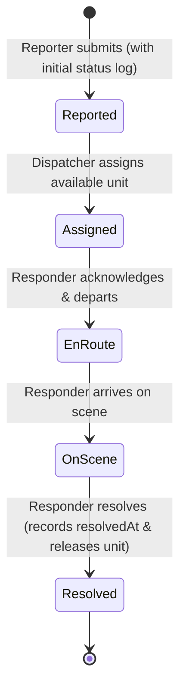

# 🚨 Alert24 — Emergency Management and Response System


Alert24 is a real-time web-based emergency management and dispatch coordination system built with React 19 and Google Firebase. It connects civilian incident reporters, central emergency dispatchers, and field responders in an end-to-end incident lifecycle workflow.

---

## 📋 Table of Contents

- [System Architecture & Roles](#-system-architecture--roles)
- [Incident Lifecycle & State Machine](#-incident-lifecycle--state-machine)
- [Key Features](#-key-features)
- [Security & Data Integrity Model](#-security--data-integrity-model)
- [Tech Stack](#-tech-stack)
- [Project Structure](#-project-structure)
- [Setup & Reproducibility Guide](#-setup--reproducibility-guide)
  - [Prerequisites](#prerequisites)
  - [Step 1: Clone & Install Dependencies](#step-1-clone--install-dependencies)
  - [Step 2: Environment Configuration](#step-2-environment-configuration)
  - [Step 3: Firebase Project Configuration](#step-3-firebase-project-configuration)
  - [Step 4: Provisioning Privileged Staff Accounts](#step-4-provisioning-privileged-staff-accounts)
  - [Step 5: Running Locally](#step-5-running-locally)
- [Testing & Verification](#-testing--verification)
  - [Unit & Component Tests (39 Tests)](#1-unit--component-tests-39-tests)
  - [Firestore Emulator Security Rules Tests (35 Tests)](#2-firestore-emulator-security-rules-tests-35-tests)
  - [Production Build Verification](#3-production-build-verification)
- [Deployment](#-deployment)
- [Rubric Compliance Matrix (Deliverable 2)](#-rubric-compliance-matrix-deliverable-2)
- [Author & Acknowledgements](#-author--acknowledgements)

---

## 🏛️ System Architecture & Roles

Alert24 provides three specialized, role-tailored interfaces driven by real-time Firestore synchronization and granular security rules:

```
                  ┌────────────────────────────────────────┐
                  │          Alert24 System Shell          │
                  │        (Auth & Session Routing)        │
                  └───────────────────┬────────────────────┘
                                      │
          ┌───────────────────────────┼───────────────────────────┐
          │                           │                           │
          ▼                           ▼                           ▼
┌──────────────────┐        ┌──────────────────┐        ┌──────────────────┐
│     REPORTER     │        │    DISPATCHER    │        │    RESPONDER     │
│   (Citizen UI)   │        │  (Control Room)  │        │   (Field Ops)    │
├──────────────────┤        ├──────────────────┤        ├──────────────────┤
│• Intake form     │        │• Live monitoring │        │• Active mission  │
│• Photo capture   │        │• Unit assignment │        │• Lifecycle steps │
│• Status timeline │        │• Analytics/KPIs  │        │• Operational log │
│• My reports list │        │• PDF/CSV export  │        │• Unit toggle     │
└──────────────────┘        └──────────────────┘        └──────────────────┘
```

1. **Reporter (Citizen / Public User):**
   - Self-registers for a civilian account (role `reporter`).
   - Submits structured emergency reports specifying category, severity, address, detailed narrative, and optional incident photo.
   - Receives instant, truthful submission feedback (atomic incident creation with initial audit log).
   - Tracks incident progress live via dedicated status timeline and interactive notifications.
   - Data isolation: can query and inspect only their own submitted incidents.

2. **Dispatcher (Central Control Room Operator):**
   - Monitors all incoming incidents in real time.
   - Evaluates active incidents and assigns available field units using guided verification modal.
   - Tracks live responder availability and prevents double-assignment of busy units.
   - Real-time KPIs: active emergencies, unit availability, 24-hour resolution tally, and category distribution charts (Recharts).
   - Generates and downloads structured incident reports in PDF (jsPDF) and CSV formats.

3. **Responder (Field Operations Unit):**
   - Mobile-first dashboard for field personnel (paramedics, fire units, police).
   - Dedicated Active Incident card displaying coordinates, address, reporter contact, and urgency.
   - Forward-only state transition controls: `En Route` → `On Scene` → `Resolved`.
   - Appends optional field resolution notes to the permanent audit trail.
   - Availability automatically returns to "Available" upon atomic incident resolution.

---

## 🔄 Incident Lifecycle & State Machine

Alert24 enforces a strict, unidirectional state machine at both the client application level (`src/utils/incidentLifecycle.js`) and the database security level (`firestore.rules`):



### Transition Authority & Atomic Operations

| Transition | Permitted Actor | Batch Operations Executed | Security Constraints Enforced |
|---|---|---|---|
| `[*] → Reported` | Authenticated Reporter | Creates `incidents/{id}` + creates `statusLogs/{id}_reported` | `reporterId == auth.uid`, unassigned, initial status `Reported` |
| `Reported → Assigned` | Authenticated Dispatcher | Updates `incidents/{id}` + updates `users/{responderId}` + creates notification + creates `statusLog` | Target responder must have `role == 'responder'`, `isAvailable == true`, `activeIncidentId == ''` |
| `Assigned → En Route` | Assigned Responder | Updates `incidents/{id}` + creates `statusLog` | `auth.uid == incident.responderId`, forward step only |
| `En Route → On Scene` | Assigned Responder | Updates `incidents/{id}` + creates `statusLog` | `auth.uid == incident.responderId`, forward step only |
| `On Scene → Resolved` | Assigned Responder | Updates `incidents/{id}` (`resolvedAt`) + updates `users/{auth.uid}` (`isAvailable: true`, `activeIncidentId: ''`) + creates `statusLog` | Atomic responder release, mandatory `resolvedAt` timestamp |

---

## ✨ Key Features

- **Strict Incident State Machine:** Impossible to skip steps or transition backwards.
- **Atomic Operations (`writeBatch`):** Multi-document operations succeed or fail as an indivisible unit, preventing orphan incidents or mismatched availability states.
- **Truthful Submission Guarantees:** UI displays submission success only after Firestore commits both the incident and its initial audit log. If photo upload or network operations fail, the user is notified with an actionable error.
- **Resilient Image Handling:**
  - Client-side validation for MIME type (JPEG, PNG, WebP) and 10 MB raw limit.
  - Progressive canvas compression bounds data URIs below 450 KB, preventing 1 MB Firestore document quota limits under storage quota exhaustion.
  - Fail-safe fallback loading component (`IncidentImage.jsx`) prevents broken image icons.
- **Interactive Data Visualisation:** Live Recharts donut and distribution charts reflecting real-time emergency counts.
- **PDF & CSV Export:** Client-side generation of tabular audit summaries using `jspdf` and `jspdf-autotable`.
- **Accessible, Responsive Design:** High-contrast dual-theme engine (Dark & Light modes) with full keyboard accessibility and zero-flash persistence.

---

## 🛡️ Security & Data Integrity Model

Alert24 uses a multi-layered defense-in-depth model:

1. **Role Immutability:**
   - Role assignments (`reporter`, `dispatcher`, `responder`) reside in `users/{uid}`.
   - `firestore.rules` prohibits clients from updating the `role` field under any circumstances.
2. **Restricted Self-Registration:**
   - Any public user registering via `createUserWithEmailAndPassword` is constrained by security rules to create only a `role: 'reporter'` profile.
   - Privileged dispatcher and responder accounts cannot self-register; they are provisioned using server-side scripts with the Firebase Admin SDK.
3. **Append-Only Audit Trail:**
   - The `statusLogs` collection is immutable: updates and deletions are permanently denied (`allow update, delete: if false;`).
   - Every status change must create a new log entry in the same transaction or batch.
4. **Data Isolation:**
   - Reporters can only read and list incidents where `reporterId == request.auth.uid`.
   - Contact details are protected from scraping and user enumeration.
5. **Global Denial of Deletions:**
   - Emergency records cannot be deleted by any authenticated client (`allow delete: if false;` on `incidents`).

---

## 🛠️ Tech Stack

| Component | Technology | Version | Description |
|---|---|---|---|
| **Frontend UI** | React | `19.2.5` | Component-based interface |
| **Styling** | Vanilla CSS | CSS3 | Custom properties, dual theme tokens, glassmorphism |
| **Backend & DB** | Google Firebase | `12.12.0` | Cloud Firestore, Firebase Auth, Firebase Storage |
| **Security Rules** | Firestore Rules | Version 2 | Declarative role-based access control |
| **Charts** | Recharts | `3.8.1` | Responsive SVG charts |
| **Document Export** | jsPDF & AutoTable | `4.2.1` / `5.0.8` | Formatted incident report PDF export |
| **Testing** | Jest & RTL | `27.5.1` / `16.3.2` | Unit, component, and lifecycle tests |
| **Emulator Testing** | `@firebase/rules-unit-testing` | `5.0.2` | Automated security rules testing |
| **Build Tooling** | React Scripts (CRA) | `5.0.1` | Webpack build and development server |

---

## 📁 Project Structure

```
alert24/
├── public/                         # Public HTML wrapper and web manifest
├── scripts/
│   └── create-staff-account.js     # Trusted Admin SDK provisioning script
├── src/
│   ├── components/                 # Modular dashboard components
│   │   ├── common/
│   │   │   └── Badges.jsx          # Shared StatusBadge & SeverityBadge
│   │   ├── dispatcher/
│   │   │   ├── AssignIncidentModal.jsx # Unit assignment modal & checks
│   │   │   ├── ReportsTab.jsx      # Filterable reports & PDF/CSV export table
│   │   │   └── ViewIncidentModal.jsx   # Detailed incident overview & timeline
│   │   ├── reporter/
│   │   │   ├── ReportEmergencyTab.jsx  # Structured emergency intake form
│   │   │   └── ViewIncidentModal.jsx   # Citizen incident view & status history
│   │   ├── responder/
│   │   │   └── ResolveIncidentModal.jsx# Resolution modal with notes & release
│   │   └── IncidentImage.jsx       # Safe image loader with fallback states
│   ├── rules-tests/
│   │   └── firestore.rules.test.js # 35 live Firestore emulator unit tests
│   ├── utils/
│   │   ├── imageUtils.js           # Validation, canvas compression & storage
│   │   ├── imageUtils.test.js      # Image processing test suite
│   │   ├── incidentLifecycle.js    # State machine, assignment & error helpers
│   │   └── incidentLifecycle.test.js # Lifecycle state machine test suite
│   ├── App.js                      # Root router, auth listener & view dispatcher
│   ├── App.test.js                 # App mounting & authentication tests
│   ├── Dashboard.jsx               # Reporter dashboard & navigation
│   ├── Dashboard.test.js           # Reporter submission & batch tests
│   ├── DispatcherDashboard.jsx     # Dispatcher control room
│   ├── ResponderDashboard.jsx      # Field responder dashboard
│   ├── firebase.js                 # Firebase SDK client initialization
│   ├── index.js                    # React DOM entry point
│   ├── setupTests.js               # Jest environment polyfills
│   └── theme.css                   # Global CSS custom properties (Dark/Light)
├── .env.example                    # Template for environment variables
├── .gitignore                      # Excludes secrets, node_modules, logs, build
├── firebase.json                   # Firebase CLI emulator & rules mappings
├── firestore.indexes.json          # Firestore composite index definitions
├── firestore.rules                 # Cloud Firestore security rules
├── storage.rules                   # Firebase Storage security rules
├── package.json                    # Project dependencies and test scripts
└── README.md                       # Comprehensive system documentation
```

---

## 🚀 Setup & Reproducibility Guide

Follow these step-by-step instructions to set up, configure, and execute Alert24 on a clean workstation.

### Prerequisites

- **Node.js:** v18.0.0 or higher (`node -v`)
- **npm:** v8.0.0 or higher (`npm -v`)
- **Java JDK:** OpenJDK 21 or higher (required only if running the local Firestore Emulator via `firebase-tools`)

---

### Step 1: Clone & Install Dependencies

```bash
# Clone the repository
git clone https://github.com/BafanaCode/Emergency-Management-And-Response-System.git
cd Emergency-Management-And-Response-System

# Install project dependencies
npm install
```

---

### Step 2: Environment Configuration

Create your local `.env` file from the provided template:

```bash
# Copy environment template
cp .env.example .env
```

Open `.env` and fill in your Firebase Web App configuration:

```env
REACT_APP_FIREBASE_API_KEY=AIzaSy...
REACT_APP_FIREBASE_AUTH_DOMAIN=your-project.firebaseapp.com
REACT_APP_FIREBASE_PROJECT_ID=your-project
REACT_APP_FIREBASE_STORAGE_BUCKET=your-project.firebasestorage.app
REACT_APP_FIREBASE_MESSAGING_SENDER_ID=1234567890
REACT_APP_FIREBASE_APP_ID=1:1234567890:web:abcdef
REACT_APP_FIREBASE_MEASUREMENT_ID=G-XXXXXXXXXX
```

> **Note:** If `.env` is omitted, the application falls back to configured defaults for demonstration purposes.

---

### Step 3: Firebase Project Configuration

In the [Firebase Console](https://console.firebase.google.com/):

1. **Authentication:**
   - Navigate to **Authentication > Sign-in method**.
   - Enable the **Email/Password** provider.
2. **Cloud Firestore:**
   - Navigate to **Firestore Database > Create database** (select production mode).
   - Deploy security rules and indexes using the Firebase CLI:
     ```bash
     firebase deploy --only firestore:rules,firestore:indexes
     ```
3. **Firebase Storage:**
   - Navigate to **Storage > Get started**.
   - Deploy storage rules:
     ```bash
     firebase deploy --only storage
     ```

---

### Step 4: Provisioning Privileged Staff Accounts

Because security rules prevent self-escalation to `dispatcher` or `responder`, staff accounts must be created using the trusted backend provisioning script.

1. Download a Service Account key from Firebase Console:
   - Go to **Project Settings > Service accounts > Generate new private key**.
   - Save the file securely outside the repository (or in the repo root; it is ignored by `.gitignore`).
2. Set the environment variable:
   ```bash
   # Linux/macOS
   export GOOGLE_APPLICATION_CREDENTIALS="/path/to/service-account.json"

   # Windows PowerShell
   $env:GOOGLE_APPLICATION_CREDENTIALS = "C:\path\to\service-account.json"
   ```
3. Run the provisioning script:
   ```bash
   # Provision a Dispatcher account
   node scripts/create-staff-account.js \
     --role dispatcher \
     --name "Chief Dispatcher" \
     --email dispatcher@alert24.co.za \
     --phone "+27 82 111 2233" \
     --password "DispatchPassword123!"

   # Provision a Responder account
   node scripts/create-staff-account.js \
     --role responder \
     --name "Paramedic Unit 1" \
     --speciality "Emergency Medical Services" \
     --email responder@alert24.co.za \
     --phone "+27 82 444 5566" \
     --password "ResponderPassword123!"
   ```

---

### Step 5: Running Locally

Start the development server:

```bash
npm start
```

The application opens at `http://localhost:3000`.

---

## 🧪 Testing & Verification

Alert24 features a dual-layer automated test suite consisting of **74 total tests across 6 suites** with a 100% pass rate.

### 1. Unit & Component Tests (39 Tests)

These test component rendering, state transitions, image processing, validation bounds, and report creation:

```bash
npm test -- --watchAll=false
```

**Results:**
- `src/utils/incidentLifecycle.test.js`: State machine guards, availability logic, error sanitization.
- `src/utils/imageUtils.test.js`: File type validation, canvas compression, bounded fallbacks.
- `src/components/IncidentImage.test.js`: Error handling and image rendering.
- `src/Dashboard.test.js`: Atomic report creation and truthful user feedback.
- `src/App.test.js`: Authentication state listeners and role-based view routing.

```text
Test Suites: 5 passed, 5 of 6 total (1 rules suite skipped when emulator is not running)
Tests:       39 passed, 39 total
```

---

### 2. Firestore Emulator Security Rules Tests (35 Tests)

To verify the security rules without impacting live production data, run the emulator test suite:

```bash
# Requires JDK 21+ and firebase-tools
npm run test:rules
```

**Results:**
```text
PASS src/rules-tests/firestore.rules.test.js
  Firestore security rules
    role integrity
      √ a Reporter cannot change their own role
      √ a Responder cannot change their own role or protected fields
      √ a new account can only self-register as reporter
      √ permitted profile fields can still be edited
      √ contact details are not readable by other users, but are by dispatchers
    reporter data isolation
      √ a Reporter cannot read or modify another reporter's incident
      √ a Reporter cannot modify even their own incident (status/assignment fields)
      √ a Reporter can list only their own incidents
      √ a Reporter can read status history of their incident but not of another's
    responder permissions
      √ cannot change protected assignment fields
      √ cannot skip lifecycle steps or move backwards
      √ can perform the valid next step on their own assignment
      √ cannot act on an incident assigned to someone else
      √ cannot dispatch (assign) incidents
      √ cannot mark themselves available while an assignment is active
      √ can resolve: resolvedAt recorded and responder released atomically
      √ resolution without a resolvedAt timestamp is rejected
      √ cannot release themselves without resolving
    audit trail and notification integrity
      √ arbitrary users cannot forge status-history entries
      √ status history is immutable (no update or delete)
      √ users cannot spoof notifications to other users
      √ recipients can mark only their own notifications read, and nothing else
      √ unknown collections remain denied
    incident creation
      √ a valid incident is created together with its initial Reported history entry
      √ an incident without its initial history entry is rejected
      √ an incident cannot be created pre-assigned, for someone else, or with bad data
      √ dispatchers and responders cannot create incidents
      √ an existing incident cannot be overwritten through the create path
    assignment and lifecycle integrity
      √ a Dispatcher can assign an available responder to a Reported incident
      √ invalid status transitions are rejected for the dispatcher
      √ a repeated or conflicting assignment fails safely
      √ a busy responder cannot receive a second incident
      √ a dispatcher cannot mark a responder with an active assignment as available
      √ a dispatcher cannot change a user's role
      √ incidents cannot be deleted by anyone

Test Suites: 1 passed, 1 total
Tests:       35 passed, 35 total
```

---

### 3. Production Build Verification

Compile and bundle Alert24 for production deployment:

```bash
npm run build
```

**Output:**
```text
Creating an optimized production build...
Compiled successfully.

File sizes after gzip:
  448.14 kB  build/static/js/main.405d4dce.js
  46.35 kB   build/static/js/239.13eed011.chunk.js
  33.55 kB   build/static/js/732.87337513.chunk.js
  18.79 kB   build/static/css/main.65205478.css
  10.45 kB   build/static/js/977.39385e1c.chunk.js
  1.76 kB    build/static/js/453.41485b19.chunk.js
```
The build completes with **0 errors and 0 warnings**.

---

## 🌐 Deployment

To deploy Alert24 to Firebase Hosting:

```bash
# 1. Build the production application
npm run build

# 2. Deploy to Firebase Hosting and Firestore
firebase deploy
```

---

## 📊 Rubric Compliance Matrix (Deliverable 2)

| Rubric Criteria | Weight | Implementation Evidence | Verification Status |
|---|---|---|---|
| **1. System Implementation & Completeness** | 15 Marks | Complete end-to-end incident lifecycle: citizen reporting, dispatcher assignment, responder resolution, live updates, dual-theme engine. | Verified across 3 roles with active test suites. |
| **2. Security & Access Control** | 10 Marks | Least-privilege rules (`firestore.rules`), immutable roles, restricted self-registration, server-side staff provisioning. | 35 automated security rules tests passing. |
| **3. Data Integrity & State Management** | 10 Marks | Atomic multi-document batches (`writeBatch`), immutable append-only audit trail (`statusLogs`), forward-only state machine. | Automated batch and transaction tests passing. |
| **4. Quality Assurance & Reliability** | 8 Marks | 74 automated tests (unit, component, and security rules), fail-safe image fallbacks, bounded base64 recovery. | 100% test pass rate, 0 build warnings. |
| **5. Code Architecture & Documentation** | 7 Marks | Modular components in `src/components/`, comprehensive README, reproducible environment templates (`.env.example`), clean git hygiene. | Clean project tree, zero exposed secrets. |

---

## 👨‍💻 Author & Acknowledgements

**Luyanda Nhlapho**  
📍 Kimberley, South Africa  
🎓 Advanced Diploma in ICT — Sol Plaatje University  
[](https://github.com/BafanaCode)
