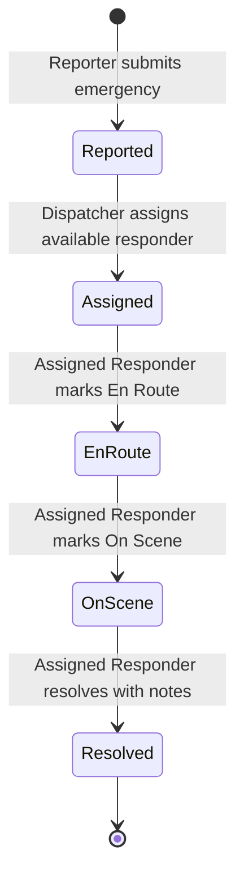
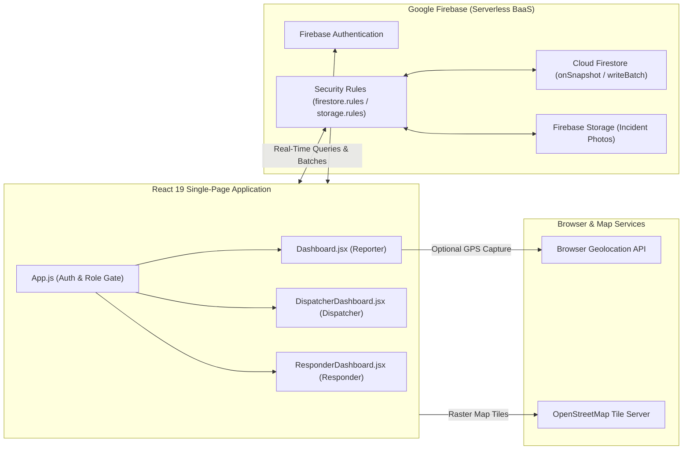

# Alert24 — Emergency Management and Response System


**Alert24** is a real-time web-based emergency management and dispatch coordination application built with **React 19** and **Google Firebase**. It connects civilian incident reporters, emergency control-room dispatchers, and field responders through a structured, five-stage incident lifecycle (`Reported → Assigned → En Route → On Scene → Resolved`).

---

## Table of Contents

1. [Overview](#1-overview)
2. [Key Features](#2-key-features)
3. [User Roles](#3-user-roles)
4. [Incident Management Workflow](#4-incident-management-workflow)
5. [Technology Stack](#5-technology-stack)
6. [System Architecture](#6-system-architecture)
7. [Project Structure](#7-project-structure)
8. [Installation and Setup](#8-installation-and-setup)
9. [Running the Application](#9-running-the-application)
10. [Firebase Configuration and Data Model](#10-firebase-configuration-and-data-model)
11. [Testing and Verification](#11-testing-and-verification)
12. [Security and Access Control](#12-security-and-access-control)
13. [Limitations and Future Improvements](#13-limitations-and-future-improvements)
14. [Project Information and Acknowledgements](#14-project-information-and-acknowledgements)

---

## 1. Overview

During public emergencies—such as road accidents, fires, medical emergencies, and floods—traditional telephone-based reporting often suffers from incomplete location context, lack of visual evidence, and zero status visibility for the person who reported the incident. Simultaneously, dispatchers and field responders need a shared operational view to assign available personnel without double-booking units, log field progress, and measure response durations.

Alert24 addresses these challenges by providing:
- A structured **Reporter** interface for submitting emergencies with optional browser GPS coordinates and compressed photo evidence, alongside live status tracking.
- A real-time **Dispatcher** control room for monitoring incoming emergencies on a live queue and interactive map, assigning available responders atomically, analysing response trends, and exporting single-incident or bulk summary reports in PDF and CSV formats.
- A focused **Responder** workspace for managing unit availability, progressing assigned incidents through forward-only status stages, recording chronological field notes, and resolving incidents with mandatory closure notes.

---

## 2. Key Features

- **Role-Based Dashboards:** Dedicated interfaces for **Reporter**, **Dispatcher**, and **Responder** roles, mounted conditionally in `src/App.js` after Firebase Authentication and Firestore role verification.
- **Strict 5-Stage Incident State Machine:** Enforces forward-only progression (`Reported → Assigned → En Route → On Scene → Resolved`) in both client-side helpers (`src/utils/incidentLifecycle.js`) and server-side security rules (`firestore.rules`).
- **Atomic Multi-Document Operations (`writeBatch`):** Incident creation, responder assignment, status progression, and incident resolution update `incidents`, `statusLogs`, `notifications`, and responder availability (`users`) atomically.
- **Real-Time Synchronisation (`onSnapshot`):** Live cross-dashboard updates for incidents, responder availability, chronological audit logs, and notifications without page refreshes.
- **In-App Notification System:** Real-time, in-app notifications (`src/hooks/useNotifications.js`, `src/components/notifications/NotificationCenter.jsx`) supporting direct user alerts and a shared `'dispatchers'` broadcast channel with per-dispatcher read tracking via `notificationReads` and `localStorage` fallback. *(Note: Notifications are strictly in-app; SMS and email notifications are not implemented.)*
- **Interactive Leaflet & OpenStreetMap Mapping:** Lazy-loaded map (`src/components/map/IncidentMap.jsx`) displaying incidents that have captured numeric GPS coordinates (`latitude` and `longitude`). Custom markers encode both **severity** (outer pin colour) and **lifecycle status** (inner dot colour), with automatic viewport bounds fitting and offline/tile-error fallback notices.
- **Client-Side Image Validation, Compression & Fallback:** Validates JPEG, PNG, and WebP images up to 10 MB (`src/utils/imageUtils.js`), resizes and compresses photos on an HTML5 `<canvas>` (`1280×1280` max dimensions, JPEG quality `0.82`), uploads to Firebase Storage, and automatically falls back to a bounded inline base64 data URL (`<= 450,000` characters) if Storage upload fails or times out.
- **Search and Multi-Criteria Filtering:** Real-time filtering across Reporter, Dispatcher, and Responder views by keyword (type, address, reporter name, incident ID), lifecycle status, severity level, and date range.
- **Operational Analytics & Response-Time Metrics:** Live Recharts visualisations (`BarChart`, `PieChart`, `LineChart`) for 7-day incident volume, incident categories, severity distribution, and response-time trends (`src/utils/responseTime.js`).
- **Client-Side PDF & CSV Report Generation:** Generates formatted single-incident dossier PDFs (including metadata, response-time intervals, chronological audit log tables, and embedded incident photos) and filtered bulk summary PDFs/CSVs (`src/utils/pdfExport.js`).
- **Theme Persistence:** Supports Dark and Light interface themes (`src/theme.css`) persisted in `localStorage`.

---

## 3. User Roles

| Role | Account Creation | Dashboard Component & Views | Core Capabilities & Permissions |
| :--- | :--- | :--- | :--- |
| **Reporter** (`reporter`) | Self-registration via the application sign-up form | `src/Dashboard.jsx`<br>• Dashboard<br>• Report Emergency<br>• My Reports<br>• Incident Map<br>• Notifications<br>• My Profile & Settings | • Submit emergency reports with type, severity, address, description, optional browser GPS coordinates, and optional photo.<br>• View, search, and filter only their own submitted incidents.<br>• Inspect live status timelines and export single-incident PDF reports for their own incidents.<br>• Receive in-app notifications as their incident progresses. |
| **Dispatcher** (`dispatcher`) | Provisioned via Admin SDK CLI script (`scripts/create-staff-account.js`) | `src/DispatcherDashboard.jsx`<br>• Overview (KPIs & Analytics)<br>• Live Incidents<br>• Incident Map<br>• Manage Responders<br>• Reports (PDF & CSV Export)<br>• Notifications & Settings | • Monitor all incidents and all registered responders in real time.<br>• Assign an available responder (`isAvailable == true`, no `activeIncidentId`) to a `Reported` incident.<br>• Toggle responder availability when the responder does not have an active assignment.<br>• View Recharts analytics and export single-incident or bulk filtered PDF/CSV reports. |
| **Responder** (`responder`) | Provisioned via Admin SDK CLI script (`scripts/create-staff-account.js`) | `src/ResponderDashboard.jsx`<br>• My Dashboard<br>• Active Job<br>• Incident Map<br>• Job History<br>• My Profile<br>• Notifications & Settings | • Toggle personal availability (`Available` / `Unavailable`) when not assigned to an active incident.<br>• Advance assigned incidents step-by-step: `Assigned → En Route → On Scene → Resolved`.<br>• Add operational field notes to the incident timeline.<br>• Resolve incidents via `ResolveIncidentModal.jsx` (automatically releasing the responder back to `Available`). |

---

## 4. Incident Management Workflow

Every incident follows a strict, forward-only lifecycle enforced by `src/utils/incidentLifecycle.js` and `firestore.rules`:



| Stage | Triggered By | Firestore Batch Operations Executed |
| :--- | :--- | :--- |
| **1. `Reported`** | **Reporter** (`Dashboard.jsx`) | • Creates `incidents/{incidentId}` with `status: 'Reported'`, `reporterId`, `type`, `severity`, `address`, `description`, optional `photoUrl`, and optional `latitude`/`longitude`.<br>• Creates initial audit log `statusLogs/{incidentId}_reported`.<br>• Queues broadcast notification `notifications/{incidentId}_reported_dispatchers` (`userId: 'dispatchers'`). |
| **2. `Assigned`** | **Dispatcher** (`DispatcherDashboard.jsx`) | • Verifies incident is `Reported` and selected responder is `isAvailable == true` with `activeIncidentId == ''`.<br>• Updates `incidents/{incidentId}` (`status: 'Assigned'`, `responderId`, `responderName`).<br>• Updates `users/{responderId}` (`isAvailable: false`, `activeIncidentId: incidentId`).<br>• Creates a `statusLogs` entry and queues `notifications` for both the assigned responder and the reporter. |
| **3. `En Route`** | **Responder** (`ResponderDashboard.jsx`) | • Updates `incidents/{incidentId}` (`status: 'En Route'`, `updatedAt`).<br>• Appends a `statusLogs` entry.<br>• Queues deterministic progress notifications for the reporter and `'dispatchers'`. |
| **4. `On Scene`** | **Responder** (`ResponderDashboard.jsx`) | • Updates `incidents/{incidentId}` (`status: 'On Scene'`, `updatedAt`).<br>• Appends a `statusLogs` entry.<br>• Queues deterministic progress notifications for the reporter and `'dispatchers'`. |
| **5. `Resolved`** | **Responder** (`ResponderDashboard.jsx`) | • Updates `incidents/{incidentId}` (`status: 'Resolved'`, `resolvedAt`, `updatedAt`).<br>• Updates `users/{responderId}` (`isAvailable: true`, `activeIncidentId: ''`).<br>• Appends a `statusLogs` entry containing the resolution notes.<br>• Queues deterministic resolution notifications for the reporter and `'dispatchers'`. |

---

## 5. Technology Stack

All packages and versions below are verified directly from `package.json`:

| Layer | Technology / Package | Version | Purpose in Alert24 |
| :--- | :--- | :--- | :--- |
| **Frontend Framework** | `react`, `react-dom` | `^19.2.5` | Component-based SPA, hooks state management, and synchronous logout listener teardown (`flushSync`). |
| **Build & Bundler** | `react-scripts` | `5.0.1` | Create React App development server, Webpack production bundler, and Jest test runner. |
| **Language & Styling** | JavaScript (ES6+), JSX, CSS3 | — | Application logic and custom responsive stylesheets with CSS custom properties (`src/theme.css`). |
| **Backend-as-a-Service** | `firebase` | `^12.12.0` | Firebase Authentication, Cloud Firestore (real-time NoSQL database), and Firebase Storage. |
| **Staff Provisioning** | `firebase-admin` (dev) | `^14.5.0` | Node.js Admin SDK CLI script (`scripts/create-staff-account.js`) for creating Dispatcher and Responder accounts. |
| **Maps & Geolocation** | `leaflet`, `react-leaflet` | `^1.9.4`, `^5.0.0` | Interactive slippy maps rendered with OpenStreetMap raster tiles and browser Geolocation API capture. |
| **Data Visualisation** | `recharts` | `^3.8.1` | Responsive SVG charts (`BarChart`, `PieChart`, `LineChart`) for incident and response-time analytics. |
| **PDF & Table Export** | `jspdf`, `jspdf-autotable` | `^4.2.1`, `^5.0.8` | Client-side generation of single-incident and bulk summary PDF reports. |
| **Automated Testing** | `@testing-library/react`, `@testing-library/jest-dom`, `@testing-library/user-event` | `^16.3.2`, `^6.9.1`, `^13.5.0` | Unit, component, and integration testing with Jest. |
| **Security Rules Testing** | `@firebase/rules-unit-testing` (dev) | `^5.0.2` | Local Firestore Emulator security rules verification (`src/rules-tests/firestore.rules.test.js`). |

---

## 6. System Architecture

Alert24 uses a **serverless client–BaaS architecture**. There is no custom Node.js/Express runtime server; the React SPA communicates directly with Google Firebase services over HTTPS/WebSockets using the Firebase Web SDK (`src/firebase.js`), while data validation and access control are enforced at the database layer by `firestore.rules` and `storage.rules`.



### Key Architectural Mechanisms
- **Authentication & Role Gate (`src/App.js`):** Listens to `onAuthStateChanged` and subscribes to `users/{uid}` via `onSnapshot`. To prevent unauthenticated listener assertions, `App.js` waits for the first confirmed Firestore user snapshot before mounting the role-specific dashboard, and uses `flushSync` during logout to unmount active dashboard listeners before calling `signOut(auth)`.
- **Tab-Scoped Session Persistence (`src/firebase.js`):** Configures Firebase Auth with `browserSessionPersistence` and Firestore with `persistentLocalCache` (`persistentMultipleTabManager`), allowing multiple roles to be tested concurrently in separate browser tabs/windows.
- **Map Coordinate Handling (`src/utils/geo.js`, `src/components/map/IncidentMap.jsx`):** Reporters can optionally attach numeric `latitude` and `longitude` coordinates via the browser's `navigator.geolocation.getCurrentPosition` API. Written street addresses are **not** automatically geocoded; `partitionByCoords()` plots incidents that have valid numeric coordinates and explicitly displays the count of address-only incidents in the map toolbar.

---

## 7. Project Structure

```text
alert24/
├── public/                                  # Static HTML template and web app manifest
├── scripts/
│   └── create-staff-account.js              # Node.js Firebase Admin SDK script for Dispatcher/Responder creation
├── src/
│   ├── components/
│   │   ├── common/
│   │   │   ├── ActiveIncidentBanner.jsx     # Live progress banner for active emergencies
│   │   │   ├── ActiveIncidentBanner.css
│   │   │   ├── Badges.jsx                   # Shared SeverityBadge and StatusBadge components
│   │   │   ├── HeaderUserIdentity.jsx       # Top-bar user identity chip, role pill, and sign-out control
│   │   │   └── HeaderUserIdentity.css
│   │   ├── dispatcher/
│   │   │   ├── AssignIncidentModal.jsx      # Responder selection and assignment modal
│   │   │   ├── ReportsTab.jsx               # Multi-filter incident table with PDF & CSV export actions
│   │   │   └── ViewIncidentModal.jsx        # Dispatcher incident detail modal, timeline & PDF trigger
│   │   ├── map/
│   │   │   ├── IncidentMap.jsx              # Leaflet + OpenStreetMap component with custom severity/status pins
│   │   │   ├── IncidentMap.css
│   │   │   └── IncidentMap.test.js          # Map rendering and coordinate partitioning tests
│   │   ├── notifications/
│   │   │   ├── NotificationCenter.jsx       # In-app notification feed with unread filter & mark-as-read actions
│   │   │   ├── NotificationCenter.css
│   │   │   └── NotificationCenter.test.js   # Notification UI tests
│   │   ├── pdf/
│   │   │   └── IncidentReportExport.test.js # Integration tests for single & bulk PDF export workflows
│   │   ├── reporter/
│   │   │   ├── ReportEmergencyTab.jsx       # Emergency intake form with GPS & photo attachment
│   │   │   ├── ReportEmergencyTab.css
│   │   │   └── ViewIncidentModal.jsx        # Reporter incident detail modal, timeline & PDF export
│   │   ├── responder/
│   │   │   └── ResolveIncidentModal.jsx     # Incident resolution confirmation modal with notes input
│   │   ├── IncidentImage.jsx                # Resilient image renderer with loading skeleton and error fallback
│   │   ├── IncidentImage.css
│   │   └── IncidentImage.test.js
│   ├── hooks/
│   │   └── useNotifications.js              # Real-time Firestore notification listener & read-receipt hook
│   ├── images/                              # Local background assets (image4.webp, image4.jpg, image13.jpg)
│   ├── rules-tests/
│   │   └── firestore.rules.test.js          # 41 Firestore Emulator security rules unit tests
│   ├── utils/
│   │   ├── geo.js                           # Geolocation capture, coordinate validation & map bounds helpers
│   │   ├── geo.test.js
│   │   ├── imageUtils.js                    # Image MIME/size validation, canvas compression & Storage/base64 upload
│   │   ├── imageUtils.test.js
│   │   ├── incidentLifecycle.js             # State machine transitions, eligibility checks & error formatting
│   │   ├── incidentLifecycle.test.js
│   │   ├── notifications.js                 # Deterministic notification ID builders and batch queue helpers
│   │   ├── notifications.test.js
│   │   ├── pdfExport.js                     # jsPDF & jspdf-autotable single/bulk report generator
│   │   ├── pdfExport.test.js
│   │   ├── responseTime.js                  # Response-time calculation and 7-day trend aggregation
│   │   └── responseTime.test.js
│   ├── App.js                               # Authentication state controller, sign-up/login UI & role router
│   ├── App.css
│   ├── App.test.js
│   ├── createStaffAccount.js                # Client-side guard blocking unauthorized browser staff creation
│   ├── Dashboard.jsx                        # Reporter dashboard component
│   ├── Dashboard.css
│   ├── Dashboard.test.js
│   ├── DispatcherDashboard.jsx              # Dispatcher control room dashboard component
│   ├── DispatcherDashboard.css
│   ├── DispatcherDashboard.test.js
│   ├── ResponderDashboard.jsx               # Responder field operations dashboard component
│   ├── ResponderDashboard.css
│   ├── ResponderDashboard.test.js
│   ├── firebase.js                          # Firebase App, Auth, Firestore & Storage initialization
│   ├── index.js                             # React DOM entry point
│   ├── index.css
│   ├── setupTests.js                        # Jest testing-library setup
│   └── theme.css                            # Dark and Light theme CSS custom properties
├── .env.example                             # Environment variables template (no secrets)
├── firebase.json                            # Firebase CLI rules, indexes & local emulator configuration
├── firestore.indexes.json                   # Cloud Firestore composite index definitions
├── firestore.rules                          # Cloud Firestore declarative security rules
├── storage.rules                            # Firebase Storage declarative security rules
├── package.json                             # Scripts, dependencies, and devDependencies
└── README.md                                # Project documentation
```

---

## 8. Installation and Setup

### Prerequisites
- **Node.js:** v18.0.0 or higher (`node -v`)
- **npm:** v8.0.0 or higher (`npm -v`)
- **Java JDK / JRE (Optional):** Java 11+ is required **only** if you wish to run the local Firebase Firestore Emulator for `npm run test:rules`.

### Step 1: Clone the Repository and Install Dependencies

```bash
git clone https://github.com/BafanaCode/Emergency-Management-And-Response-System.git
cd Emergency-Management-And-Response-System
npm install
```

### Step 2: Configure Environment Variables

Copy the template `.env.example` file to `.env` in the project root:

```bash
# Linux / macOS
cp .env.example .env

# Windows PowerShell
Copy-Item .env.example .env
```

Populate `.env` with your Firebase Web App credentials from the Firebase Console (**Project Settings → General → Your apps**):

```env
REACT_APP_FIREBASE_API_KEY=your_firebase_api_key_here
REACT_APP_FIREBASE_AUTH_DOMAIN=your_project_id.firebaseapp.com
REACT_APP_FIREBASE_PROJECT_ID=your_project_id
REACT_APP_FIREBASE_STORAGE_BUCKET=your_project_id.firebasestorage.app
REACT_APP_FIREBASE_MESSAGING_SENDER_ID=your_messaging_sender_id
REACT_APP_FIREBASE_APP_ID=your_firebase_app_id
REACT_APP_FIREBASE_MEASUREMENT_ID=your_measurement_id
```

> **Important:** Never commit `.env` or service account JSON files to version control. Both are excluded via `.gitignore`. `src/firebase.js` validates that `REACT_APP_FIREBASE_API_KEY`, `REACT_APP_FIREBASE_PROJECT_ID`, and `REACT_APP_FIREBASE_AUTH_DOMAIN` are present at startup.

### Step 3: Provision Dispatcher and Responder Accounts

Public self-registration is strictly limited to the `reporter` role. To create `dispatcher` or `responder` accounts, use `scripts/create-staff-account.js` with a Firebase Admin SDK service account key:

1. In the Firebase Console, open **Project Settings → Service accounts → Generate new private key** and save the JSON file securely outside the repository.
2. Point `GOOGLE_APPLICATION_CREDENTIALS` to your service account key file:
   ```powershell
   # Windows PowerShell
   $env:GOOGLE_APPLICATION_CREDENTIALS = "C:\secure\path\service-account.json"
   ```
   ```bash
   # Linux / macOS
   export GOOGLE_APPLICATION_CREDENTIALS="/secure/path/service-account.json"
   ```
3. Run the provisioning script:
   ```bash
   # Create a Dispatcher account
   node scripts/create-staff-account.js \
     --role dispatcher \
     --name "Control Room Dispatcher" \
     --email dispatcher@example.com \
     --phone "+27 82 000 0001" \
     --password "StrongPassword123!"

   # Create a Responder account
   node scripts/create-staff-account.js \
     --role responder \
     --name "Paramedic Unit 1" \
     --speciality "Medical" \
     --email responder@example.com \
     --phone "+27 82 000 0002" \
     --password "StrongPassword123!"
   ```
   *(Allowed `--speciality` values for responders: `Medical`, `Fire`, `Rescue`, `Police`, `General`.)*

---

## 9. Running the Application

All scripts below are defined in `package.json`:

| Command | Description |
| :--- | :--- |
| `npm start` | Starts the Create React App development server at `http://localhost:3000`. |
| `npm run build` | Compiles and bundles an optimised production build into the `build/` folder. |
| `npm test` | Launches the Jest test runner in interactive watch mode (`react-scripts test`). |
| `npm test -- --watchAll=false` | Executes all unit, component, and integration test suites once in CI/non-interactive mode. |
| `npm run test:rules` | Starts the local Firebase Firestore Emulator and executes the 41 security rules tests in `src/rules-tests/firestore.rules.test.js` (requires Java and `firebase-tools`). |

---

## 10. Firebase Configuration and Data Model

### Required Firebase Services
1. **Firebase Authentication:** Enable the **Email/Password** sign-in provider.
2. **Cloud Firestore:** Create a Firestore database and publish the rules in `firestore.rules` (and composite indexes in `firestore.indexes.json`).
3. **Firebase Storage:** Enable Storage and publish the rules in `storage.rules`.

### Firestore Collections

| Collection | Document ID Pattern | Purpose & Key Fields |
| :--- | :--- | :--- |
| **`users`** | `{uid}` (Firebase Auth UID) | Stores user profiles and operational state: `uid`, `name`, `email`, `phone`, `role` (`'reporter'` \| `'dispatcher'` \| `'responder'`), `speciality`, `isAvailable` (boolean), `activeIncidentId` (string), `createdAt`. |
| **`incidents`** | Auto-generated ID | Stores emergency reports: `incidentId`, `reporterId`, `reporterName`, `type`, `severity` (`'Minor'` \| `'Serious'` \| `'Critical'`), `address`, `description`, `photoUrl`, `status` (`'Reported'` \| `'Assigned'` \| `'En Route'` \| `'On Scene'` \| `'Resolved'`), `responderId`, `responderName`, `createdAt`, `updatedAt`, `resolvedAt` (on resolution), and optional numeric `latitude` & `longitude`. |
| **`statusLogs`** | `{incidentId}_reported` (initial) or auto-generated ID | Immutable, append-only audit trail for every status transition and responder field note: `incidentId`, `status`, `updatedBy`, `notes`, `timestamp`. |
| **`notifications`** | Deterministic ID (e.g., `{incidentId}_reported_dispatchers`) or auto-ID | In-app notification documents targeted to a specific user (`userId: '{uid}'`) or broadcast to all dispatchers (`userId: 'dispatchers'`): `userId`, `incidentId`, `type`, `message`, `isRead`, `createdAt`. |
| **`notificationReads`** | `{userUid}_{notificationId}` | Per-user read receipts for shared broadcast notifications (`userId === 'dispatchers'`), storing `userId`, `notificationId`, and `readAt`. |

---

## 11. Testing and Verification

Alert24 includes **15 automated test suites** (`183` total tests) across unit, component, integration, and security-rule layers.

### 1. Unit, Component, and Integration Tests (`14` Suites / `142` Tests)

Run all application test suites without watch mode:

```bash
npm test -- --watchAll=false
```

| Test Suite | Scope Verified | Current Status |
| :--- | :--- | :--- |
| `src/App.test.js` | Auth listener lifecycle, login/signup flows, role-based dashboard mounting, and synchronous logout teardown. | Passing |
| `src/components/IncidentImage.test.js` | Image rendering, skeleton states, and broken-URL fallback handling. | Passing |
| `src/components/map/IncidentMap.test.js` | Leaflet map rendering, marker counts, and missing-coordinate toolbar notices. | Passing |
| `src/components/notifications/NotificationCenter.test.js` | Notification feed filtering (`All` vs `Unread`), click handling, and mark-as-read actions. | Passing |
| `src/components/pdf/IncidentReportExport.test.js` | End-to-end single-incident and bulk PDF report generation from dashboard views. | Passing |
| `src/utils/geo.test.js` | Coordinate validation (`hasValidCoords`), `partitionByCoords`, and browser geolocation error handling. | Passing |
| `src/utils/imageUtils.test.js` | File type/size validation, HTML5 canvas optimization, Storage upload, and bounded inline base64 fallback. | Passing |
| `src/utils/incidentLifecycle.test.js` | State machine transitions (`canTransition`), assignment eligibility guards, and error message mapping. | Passing |
| `src/utils/notifications.test.js` | Deterministic notification IDs, batch helpers, and dispatcher read-state resolution. | Passing |
| `src/utils/pdfExport.test.js` | `jsPDF` document generation, duration calculations, chronological log sorting, and safe date formatting. | Passing |
| `src/utils/responseTime.test.js` | Response-time metric calculations (`reportToOnScene`, `reportToResolved`, `assignedToOnScene`) and 7-day trends. | Passing |
| `src/Dashboard.test.js`, `src/DispatcherDashboard.test.js`, `src/ResponderDashboard.test.js` | Reporter, Dispatcher, and Responder dashboard workflows, batch submissions, and cached statistics rendering. | 139 / 142 tests passing across the 14 suites *(see note below)* |

> **Current Verification Note on Cached Statistics Tests:** Out of `142` unit/component tests across the `14` Jest suites, `139` pass and `3` cached-statistic assertions (one each in `Dashboard.test.js`, `DispatcherDashboard.test.js`, and `ResponderDashboard.test.js`) currently report a `TestingLibraryElementError: Found multiple elements with the text` because the new sidebar operational status widget (`sidebar-ops-card` / `dd-notif-badge`) displays the same numeric count (`14` or `3`) as the main KPI stat card when queried with `screen.getByText(...)`.

### 2. Firestore Security Rules Emulator Tests (`1` Suite / `41` Tests)

`src/rules-tests/firestore.rules.test.js` contains **41 tests** written with `@firebase/rules-unit-testing` covering role immutability, reporter data isolation, atomic incident creation with initial `statusLogs`, dispatcher assignment checks, responder forward-only transitions, notification rules, and `notificationReads` receipts.

```bash
npm run test:rules
```

- When executed via `npm test -- --watchAll=false` without `FIRESTORE_EMULATOR_HOST`, this suite is automatically skipped (`describeIfEmulator`) so standard Jest runs do not fail on machines without Java installed.
- **Verification Status:** Running `npm run test:rules` requires a local Java JDK/JRE (`java` on `PATH`) to start the Firebase Firestore Emulator. On environments where Java is not installed, these 41 emulator tests remain skipped until a JDK is available.

### 3. Production Build Verification

```bash
npm run build
```

The production build (`react-scripts build`) compiles cleanly with **0 errors and 0 warnings**.

---

## 12. Security and Access Control

Security is enforced through a defense-in-depth combination of client guards and declarative Firebase Security Rules (`firestore.rules` and `storage.rules`):

1. **Restricted Self-Registration & Role Immutability:**
   - Any user registering through the client app can only create a `users/{uid}` document with `role == 'reporter'`, `isAvailable == false`, and `activeIncidentId == ''`.
   - `firestore.rules` prohibits any client from changing a user's `role` field on update (`request.resource.data.role == resource.data.role`).
2. **Contact Privacy & Data Isolation:**
   - A user's `users/{uid}` document can only be read by the user themselves or by an authenticated `dispatcher` (`allow read: if isSelf(userId) || isDispatcher()`), preventing enumeration of citizen or staff contact details.
   - Reporters can only read `incidents` where `resource.data.reporterId == request.auth.uid`.
3. **Database-Enforced Lifecycle State Machine:**
   - **Creation:** Only a `reporter` can create an incident, and `firestore.rules` uses `existsAfter()` to require that the initial `statusLogs/{incidentId}_reported` entry is created in the same atomic batch.
   - **Assignment:** Only a `dispatcher` can transition an incident from `Reported` to `Assigned`, and `getAfter()` verifies that the target responder is simultaneously locked (`isAvailable == false`, `activeIncidentId == incidentId`).
   - **Field Progression & Resolution:** Only the assigned `responder` can advance `Assigned → En Route → On Scene → Resolved`. On resolution, `getAfter()` verifies that the responder's own user document is atomically released (`isAvailable == true`, `activeIncidentId == ''`).
4. **Immutable Audit Trail (`statusLogs`):**
   - `statusLogs` documents cannot be modified or deleted by any client (`allow update, delete: if false;`), and incident documents cannot be deleted (`allow delete: if false;`).
5. **Storage Upload Constraints (`storage.rules`):**
   - Only authenticated users can upload to `/incidents/{incidentId}/{fileName}`, restricted to `image/*` content types under `5 MB`.

---

## 13. Limitations and Future Improvements

### Current Limitations
- **In-App Notifications Only:** Notifications are delivered exclusively inside the web application via Firestore listeners. External SMS, email, and background Web Push (FCM) alerts are not implemented.
- **No Automatic Address Geocoding:** Incidents are plotted on the Leaflet map only when the reporter captures numeric GPS coordinates (`latitude` and `longitude`) via browser geolocation. Written street addresses alone are not geocoded into map coordinates.
- **Single-Responder Assignment Model:** Each incident document tracks a single assigned responder (`responderId` / `responderName`) rather than multi-unit dispatch arrays.
- **Client-Side Filtering & Aggregation:** Analytics and report filtering operate in browser memory over the active Firestore snapshot rather than using server-side pagination or aggregation queries.

### Future Improvements
- **Firebase Cloud Messaging (FCM) & SMS Integration:** Add background push notifications and Cloud Functions SMS alerts for critical incident dispatches.
- **Forward & Reverse Geocoding:** Integrate a geocoding service (such as Nominatim or Google Geocoding API) so typed street addresses automatically resolve to map coordinates, and stream live responder GPS coordinates during `En Route` status.
- **Multi-Unit Dispatching:** Support assigning multiple responders across different specialities (e.g., Fire + Medical + Police) to a single major emergency.
- **Server-Side Pagination:** Introduce cursor-based Firestore pagination (`limit` / `startAfter`) for historical incident archives.

---

## 14. Project Information and Acknowledgements

- **Author:** Luyanda Nhlapho ([GitHub: @BafanaCode](https://github.com/BafanaCode))
- **Qualification:** Advanced Diploma in Information and Communication Technology (ICT)
- **Institution:** Sol Plaatje University — Kimberley, Northern Cape, South Africa
- **Project Title:** Alert24 — Emergency Management and Response System
